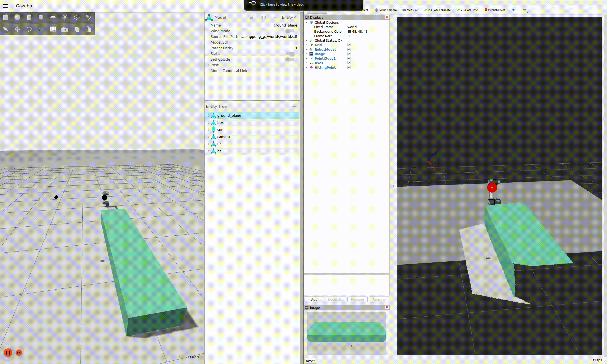

# Pingpong Robot Using a Universal Robots UR5 Cobot

Gazebo simulation of a robot system to play table tennis (kind of) using a Universal Robots cobot and a depth camera. Developed using ROS2 Humble and Gazebo Fortress.

This is an attempt at implementing this paper:

> Tebbe, J., Gao, Y., Sastre-Rienietz, M., Zell, A. (2019). A Table Tennis Robot System Using an Industrial KUKA Robot Arm. In: Brox, T., Bruhn, A., Fritz, M. (eds) Pattern Recognition. GCPR 2018. Lecture Notes in Computer Science(), vol 11269. Springer, Cham. https://doi.org/10.1007/978-3-030-12939-2_3

The trajectory of the ball was predicted using the curve fitting method.

## Dependencies

- sensor_msgs
- geometry_msgs
- message_filters
- OpenCV
- tf2
- Eigen3
- ruckig
- [trac_ik](https://github.com/aprotyas/trac_ik) ROS2 port

The [Universal_Robots_ROS2_GZ_Simulation](https://github.com/UniversalRobots/Universal_Robots_ROS2_GZ_Simulation) and [Universal_Robots_ROS2_Description](https://github.com/UniversalRobots/Universal_Robots_ROS2_Description) packages should also be present.

The `humble` branch was cloned for both repos, commit hashes at the time were:

- 68a10c2 for the description package.
- 4ffe611 for the gazebo simulation package.

## Building

Create a workspace folder:

```
mkdir -p ur_ws/src && cd ur_ws
```

Clone the ROS2 port of trac_ik then build and source it:

```
git clone https://github.com/aprotyas/trac_ik.git src/
colcon build --packages-select trac_ik_lib trac_ik_examples && source install/setup.bash
colcon build --packages-select trac_ik && source install/setup.bash
```

Clone the UR packages:

```
git clone -b humble https://github.com/UniversalRobots/Universal_Robots_ROS2_Description.git src/
git clone -b humble https://github.com/UniversalRobots/Universal_Robots_ROS2_GZ_Simulation.git src/
```

## Demo



## Issues

- The prediction error can be large enough that the robot will not hit the ball with the end effector.
- The robot sometimes recieves the predicted hitting position too late.
- If the ball is going to a position that is far from the current robot's position, the robot will fail to reach the hitting position in time.
